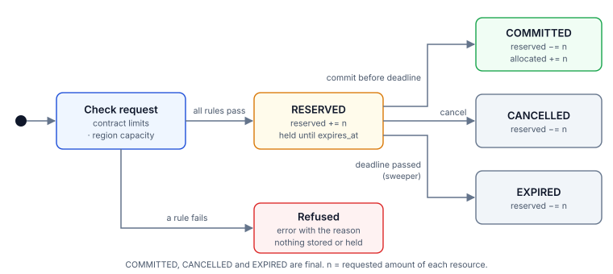
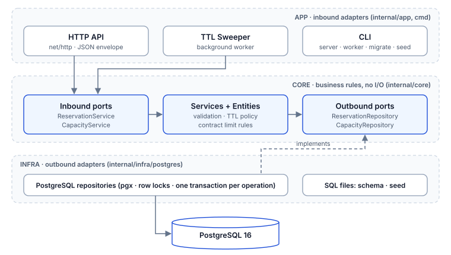
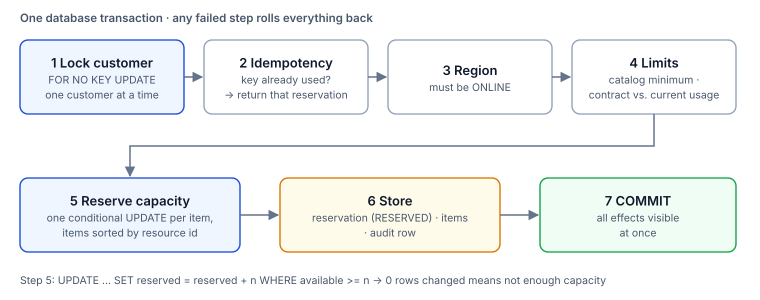
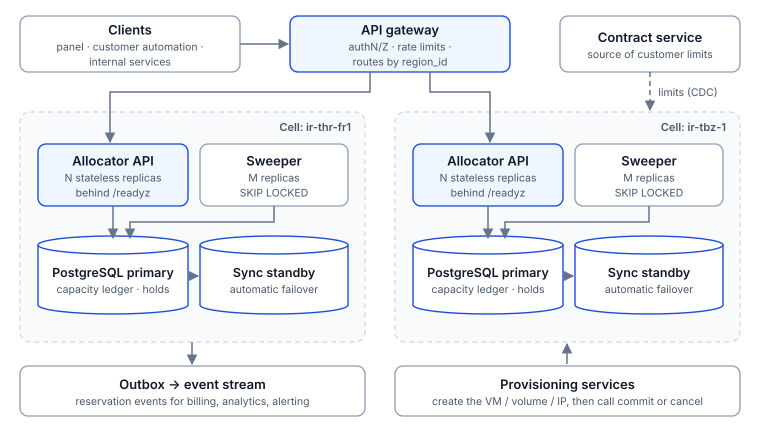

# Cloud Capacity Allocator: Design and Architecture

Repository: <https://github.com/Ehsan-Eghbali/cloud-capacity> · Persian version: [ARCHITECTURE_FA.md](ARCHITECTURE_FA.md) ([PDF](Architecture_and_Design_Document.pdf))

---

## 1. Summary

This service is the backend core of the step that runs before a cloud service is created. It decides whether the resources a customer needs can be provided, **holds** them for a short time if they can, and ends every reservation in exactly one way: **committed**, **cancelled**, or **expired** when its deadline passes.

The design gives three guarantees:

1. **Capacity the customer was told "yes" for stays theirs until the deadline**, and no resource is ever handed out beyond its sellable capacity.
2. **Sending a request again never creates a second reservation.** The earlier reservation is returned and nothing is deducted twice.
3. **No reservation is left half-done.** Every hold is committed, cancelled or expired automatically, and every change is traceable.

It is written in Go on PostgreSQL and starts with one command: `docker compose up --build`.

## 2. The problem and the design's answer

| Problem in the brief | Design answer |
|---|---|
| A customer sees capacity that is gone by the time the service is created | Two-phase reservation: capacity is deducted when the request is accepted and held until `expires_at`. Viewing capacity is a snapshot; only a reservation is a guarantee. |
| The outcome of a request is unclear, so the customer sends it again | Each request carries an `Idempotency-Key`. Repeating the key returns the same reservation. Commit and cancel are repeatable too. |
| A flow starts and never finishes | Every hold has a TTL. A background sweeper releases abandoned holds, including after a crash or outage. |
| Real capacity and request status are hard to determine | One ledger row per (region, resource) with three counters, `total / allocated / reserved`, and an audit log written in the same transaction as each change. |
| One request needs several resources | All resources of a request are checked and held in one transaction: all of them, or none. |
| Some products are scarce and run out quickly | Checking availability and deducting it is one atomic statement, and a database `CHECK` forbids selling past the total. |
| The panel, customer automation and internal services all use it | One REST API with a uniform envelope, meaningful status codes and a clear message for every refusal. |

Section 11 maps the five required capabilities to endpoints.

## 3. Assumptions

The brief leaves behaviour in unclear situations to the designer. These are the assumptions this design makes.

**Resources and capacity**

1. Capacity is tracked per (region, resource type) with three counters, and `available = total − allocated − reserved`.
2. `total_capacity` is the **sellable** capacity, not necessarily the physical one. Each resource's sales policy (overcommit for CPU, one-to-one for GPUs) is expressed by operations through this number, and the service never sells beyond it.
3. All amounts are positive integers in a base unit. "Divisible" resources (CPU, memory, storage) are a pool; "independent unit" resources (GPU, public IP) are counted. The catalog marks the difference with `is_divisible` and gives each resource a minimum amount (`min_amount`). The service manages counts; picking the concrete unit (which IP, which GPU) belongs to the provisioning service.
4. A "product" such as a virtual machine is a combination of resources chosen by the caller. The service has no product catalog; product details travel in the request's `metadata`.
5. A request belongs to exactly one region.
6. Regions, the resource catalog, capacities, customers and contracts are owned by other systems and arrive here as seed data.

**Customer limits**

7. A customer's limits are defined per resource type: a total cap, a minimum and maximum per request, and whether the resource is allowed at all.
8. **The contract cap is contract-wide**: the customer's usage in all regions is added up, because a contract is signed with a customer, not with a datacenter.
9. Usage is the sum of the customer's `RESERVED` and `COMMITTED` reservations. Cancelled and expired reservations cost nothing.
10. If no contract line exists for a resource, only the catalog minimum and the region's capacity apply. To forbid a resource, a line with `is_enabled = false` is stored.

**Lifecycle**

11. A request is checked immediately: a reservation is created, or the request is refused with the reason. There is no waiting list and no partial fulfilment.
12. A refused request is not stored. The reason is in that request's response, and sending it again (even with the same key) is checked from scratch.
13. The hold TTL is set by the server (600 seconds by default, configurable). The client cannot choose it; the value in effect is returned in the response.
14. A commit after the deadline is refused, even if the sweeper has not yet released that hold.
15. `COMMITTED` is final in this scope. Releasing capacity when a service is deleted is out of scope (section 14).

**Idempotency, identity and time**

16. `Idempotency-Key` is required to create a request, is unique per customer, and stays valid for as long as the reservation exists.
17. Two requests are "the same" when their region and the amount of each resource are equal; `metadata` is not part of the comparison. A request names each resource type once, and a repeated type is refused with `400`.
18. Authentication is out of scope. `customer_id` has been verified by an upstream gateway, and a reservation id is enough to view, commit or cancel it.
19. All deadlines are computed and compared on the database clock, not the service's.
20. PostgreSQL is the single source of truth. Without it the service accepts no requests; there is no in-memory fallback (consistency is preferred over availability).

## 4. Data model

| Table | Holds | Key point |
|---|---|---|
| `regions` | Regions and their status | Only an `ONLINE` region accepts new requests |
| `resource_types` | Resource catalog | `is_divisible`, `min_amount`, unit |
| `region_capacities` | The capacity ledger per (region, resource) | `CHECK (allocated + reserved <= total)` and non-negative counters |
| `customers` | Customers | Only an `ACTIVE` customer can reserve |
| `customer_limits` | The customer's contract | One row per (customer, resource) |
| `reservations` | Reservations and their status | `UNIQUE (customer_id, idempotency_key)` and a `CHECK` on status values |
| `reservation_items` | Amount of each resource in a reservation | One row per resource, `amount > 0` |
| `capacity_audit_logs` | History of changes | Written in the same transaction as the change |

The `CHECK` constraints are a second line of defence: even with a bug in the code, the database refuses a negative counter or an oversell and the transaction rolls back.

## 5. Reservation lifecycle



| Transition | Triggered by | Effect on the ledger | Effect on the customer's quota |
|---|---|---|---|
| create → `RESERVED` | Customer | `reserved += n` | Consumed |
| `RESERVED` → `COMMITTED` | Customer or provisioning service | `reserved −= n`, `allocated += n` | Stays consumed |
| `RESERVED` → `CANCELLED` | Customer | `reserved −= n` | Released |
| `RESERVED` → `EXPIRED` | Sweeper | `reserved −= n` | Released |

`COMMITTED`, `CANCELLED` and `EXPIRED` are final. A request that is not accepted creates no reservation and changes no counter.

## 6. Software architecture



The project is hexagonal (ports and adapters):

- **Core** (`internal/core`): entities, contract rules, input validation and interfaces. It depends on neither HTTP nor the database.
- **App** (`internal/app`, `cmd`): the ways in: the HTTP API, the sweeper and the CLI commands.
- **Infra** (`internal/infra/postgres`): the repositories on PostgreSQL. Every transaction lives here.

Checking the contract cap and deducting capacity must happen under locks, in one transaction. That is why the repository runs the steps inside the transaction, while the contract rule itself (`CustomerLimit.Validate`) stays in the core.

**Why PostgreSQL?** The problem is a consistency problem at heart: several counters and several records must change together, atomically. ACID transactions, row locks and `CHECK` constraints provide exactly that with no extra moving parts. A cache or a distributed lock next to the database would add a second source of truth and more failure modes.

## 7. Processing a reservation request



Everything happens in **one transaction**, and a failure at any step rolls all of it back:

1. **Lock the customer.** One customer's requests are processed one after another. This keeps the contract-wide cap correct across regions and lines up concurrent retries of one key.
2. **Check idempotency.** If the customer already used this key, that reservation is returned.
3. **Region.** It must exist and be `ONLINE`.
4. **Limits.** For each resource: it exists in the catalog, the amount meets the catalog minimum, and the contract caps hold against the customer's current usage.
5. **Reserve capacity.** For each resource one conditional `UPDATE` increases `reserved` only if enough is available. If no row changes, there is not enough capacity.
6. **Store.** The reservation (status `RESERVED`), its items and one audit row are saved.

| Reason for refusal | HTTP |
|---|---|
| The region does not have enough capacity | 409 |
| It would pass the contract's total cap | 422 |
| The resource is disabled in the customer's contract | 422 |
| More than the per-request maximum, or less than the minimum | 422 |
| The resource is unknown or not offered in this region | 422 |

A capacity shortage is 409 because it may succeed later as the system's state changes; the others repeat until the contract or the request changes.

## 8. Concurrency and consistency

**No overselling.** Checking availability and deducting it is one statement:

```sql
UPDATE region_capacities
SET reserved_capacity = reserved_capacity + $1
WHERE region_id = $2 AND resource_type_id = $3
  AND total_capacity - allocated_capacity - reserved_capacity >= $1;
```

PostgreSQL locks the row while it runs the `UPDATE`, so two concurrent requests cannot both see and take the same capacity; the second one is evaluated after the first, against the new value.

**Contract cap.** A customer's usage is computed from their reservations. Without a customer lock, two concurrent requests in two regions (which share no capacity row) would both read the old usage and both be accepted. A `FOR NO KEY UPDATE` lock on the customer row removes that case.

**Lock order.** Every transaction takes its locks in the same order:

1. the customer row (create only)
2. the reservation row (commit, cancel and expire)
3. capacity rows in ascending resource id order

Each transaction touches the capacity rows of a single region, and the items of a reservation are stored sorted, so this order is the same on every path. Since no transaction takes locks against it, no wait cycle and therefore no deadlock can form. The sweeper expires each hold in its own transaction to keep the same rule.

**Isolation level.** PostgreSQL's default, `READ COMMITTED`, is enough: each decision is made under the lock of the row it concerns, and each statement sees the latest committed data once it holds the lock.

**The cost.** Requests of one customer, and requests for one (region, resource), are serialized. Transactions are short and this fits the load of this problem; section 12 describes how to scale it.

## 9. Idempotency and retries

| Situation | Behaviour |
|---|---|
| First request with a key | It is checked: `201` and a new reservation, or a refusal with the reason |
| Same key, same request | `200` and the same reservation; nothing is deducted again |
| Same key, different request | `422`; the earlier reservation is untouched |
| Several concurrent sends of one key | They queue behind the customer lock; one creates the reservation, the rest receive it. The database unique constraint is the second layer |
| A request that was refused | The key is not used up; sending it again is checked from scratch |
| Commit repeated on a committed reservation | `200` with the same body, no second effect |
| Cancel repeated on a cancelled reservation | `200` with the same body, no second effect |

The key can be sent in the `Idempotency-Key` header or the `idempotency_key` body field; the header wins.

## 10. Failure and recovery

The design principle: **every operation is one database transaction and the service keeps no state in memory.** A failure therefore happens either before the transaction commits (nothing remains) or after it (the full effect is stored).

| Event | Behaviour during the failure | State after recovery |
|---|---|---|
| The service crashes in the middle of a request | PostgreSQL rolls the unfinished transaction back | No partial effect exists; the customer retries with the same key |
| The connection drops after the write and before the response | The reservation is stored but the customer does not know | Retrying with the same key returns that reservation |
| PostgreSQL becomes unavailable | `/readyz` answers 503 so the load balancer stops sending traffic; `/healthz` stays healthy so the service is not restarted needlessly; requests fail with 500 and nothing is stored | The connection pool reconnects on its own and `/readyz` turns green |
| Holds reach their deadline during an outage or shutdown | Their capacity is not released for the moment, but they cannot be committed either | On its first run after start-up the sweeper expires all of them and releases the capacity |
| The customer abandons the flow | The hold stays until its deadline | `EXPIRED` and the capacity is released |
| Several copies of the service or sweeper run at once | Each hold is expired by one conditional `UPDATE` | Each hold is expired exactly once |
| Normal shutdown (`SIGTERM`) | In-flight requests finish, the sweeper stops, the pool closes | The next start continues from the database state |

The database-outage scenario was exercised against the running service: create a hold, stop PostgreSQL, let the deadline pass, start it again. Result: during the outage `/readyz` was 503 and requests failed; after recovery the old hold was `EXPIRED` and its capacity free; the request that failed during the outage was stored exactly once when retried with the same key.

**Explainability.** Every state change has a row in `capacity_audit_logs` (`RESERVE`, `COMMIT`, `CANCEL`, `EXPIRE`), written in the same transaction, so the history always matches the real state. To verify the ledger after an incident, this query must return no rows:

```sql
SELECT c.region_id, c.resource_type_id, c.reserved_capacity,
       COALESCE(SUM(ri.amount) FILTER (WHERE r.status = 'RESERVED'), 0) AS live_holds
FROM region_capacities c
LEFT JOIN reservations r       ON r.region_id = c.region_id
LEFT JOIN reservation_items ri ON ri.reservation_id = r.id
                              AND ri.resource_type_id = c.resource_type_id
GROUP BY c.region_id, c.resource_type_id, c.reserved_capacity
HAVING c.reserved_capacity <> COALESCE(SUM(ri.amount) FILTER (WHERE r.status = 'RESERVED'), 0);
```

The integration tests assert the same condition after every concurrency scenario.

## 11. API

Every response has the shape `{"success": bool, "data": …, "error": "…"}`.

| Requirement | Method and path | Notes |
|---|---|---|
| 1. View capacity status | `GET /api/v1/regions` | Regions and their status |
| | `GET /api/v1/regions/{region_id}/capacity` | Counters and availability per resource |
| | `GET /api/v1/resources` | Resource catalog |
| 2. Submit a request | `POST /api/v1/reservations` | With `Idempotency-Key` |
| 3. Track status | `GET /api/v1/reservations/{id}` | Status and deadline of the reservation |
| 4. Complete or cancel | `POST /api/v1/reservations/{id}/commit` | Finalize |
| | `POST /api/v1/reservations/{id}/cancel` | Cancel and release |
| 5. Previous requests | `GET /api/v1/reservations?customer_id=…` | Newest first; `status`, `page`, `page_size` |
| Health | `GET /healthz`, `GET /readyz` | Liveness and readiness |

| Code | Meaning |
|---|---|
| `200` | Success, or a repeat of an operation already done |
| `201` | A new reservation was created |
| `400` | Invalid input (body, id, key, amount, repeated resource type) |
| `403` | The customer is not active |
| `404` | Customer, region or reservation not found |
| `409` | Capacity shortage; region unavailable; the reservation's state does not allow the operation; deadline passed |
| `422` | Refused by contract or catalog; key reused for a different request |
| `500` | Internal error or database unreachable; the call can be retried with the same key |

Request and response examples are in the [README](../README.md).

## 12. Growing into production



The current implementation is one service and one database. The path to a real environment:

**Multi-region.** Capacity is regional by nature, so each region becomes an independent cell: allocator replicas plus that region's PostgreSQL. The gateway routes by `region_id`, and an outage of one region or of the network between regions does not stop reservations elsewhere. The current design already fits this split, because a request belongs to one region and all capacity locks stay inside it.

**The contract-wide cap across cells.** Today one database lets the customer lock keep this cap exact. With separate databases there are two options: a synchronous check in a central service (simple, but couples the regions), or splitting each customer's cap into regional shares that each cell enforces locally while a central service rebalances them. The second is recommended, because a reservation in one region then does not depend on the health of the others.

**Availability.** PostgreSQL with a synchronous standby and automatic failover (for example Patroni) so a confirmed reservation is never lost. The service is stateless and runs as many replicas as needed behind `/readyz`. The sweeper is deployed separately with the `worker` command.

**Scale.** The natural bottleneck is the counter row of a resource in high demand. The way to raise the ceiling is to split it into smaller pools (availability zone, cluster or host aggregate), which also matches the real infrastructure more closely. `reservations` and `capacity_audit_logs` are partitioned by time and old data is archived.

**Observability.** Metrics for holds per state, the rate of each refusal reason, time from hold to commit, share of expired holds and lock wait time; a trace per request; and an alert on the consistency query of section 10.

**Integration.** Reservation events are published with the outbox pattern (the event is written in the same transaction) for billing and analytics. Contracts reach each cell by CDC from the system that owns them.

**Security.** Authentication and rate limiting at the gateway; `customer_id` is read from the token and reservation ownership is checked on commit and cancel.

**Next capabilities.** A `release` transition to free capacity when a service is deleted, hold extension for long provisioning, storing refused requests for reporting, a product catalog, a capacity management API for operations, and a versioned migration tool.

## 13. Tests and running

```bash
docker compose up --build -d      # PostgreSQL + migration + seed + service
curl http://localhost:8080/readyz
make test                         # unit tests, no database needed
make test-integration             # integration tests on PostgreSQL
```

If port `5432` or `8080` is taken on the host:

```bash
POSTGRES_HOST_PORT=5433 APP_PORT=8081 docker compose up --build -d
```

| Level | What it tests |
|---|---|
| Unit: `entity` | Contract cap rules, availability, same-request detection |
| Unit: `service` | Input validation (including a repeated resource type), hold TTL from configuration, paging |
| Unit: `http` | Status codes, header key precedence, no leaking of internal errors, readiness |
| Integration | No overselling under concurrent load; the contract cap in one region and across two; one reservation out of 20 concurrent retries; no deadlock between the sweeper and creates; commit, cancel, expire and their retries; refusal reasons; history |

The integration tests check the ledger's consistency after every scenario. To make sure they are sensitive, three key safeguards (the customer lock, the capacity lock order and the availability condition) were each removed temporarily, and the corresponding tests failed.

## 14. Known limitations

- **No release after commit.** `COMMITTED` capacity and quota are not freed until a `release` transition exists.
- **No hold extension.** If provisioning outlasts the deadline, the commit is refused and the upstream service must reserve again. Until then the TTL has to fit the slowest product.
- **One region per request.** A multi-region service takes several reservations and coordinates them itself.
- **Viewing capacity is not a guarantee.** `available` can change before a request is submitted.
- **An expired hold still reads as `RESERVED`, and its capacity is not yet free, until the next sweeper run (5 seconds by default).** Commit has no such delay and enforces the deadline exactly.
- **Refused requests are not in the history.** The history shows created reservations only.
- **Migrations have no version table.** There is one schema file, written to be re-runnable; a real environment needs a versioned tool.
- **Offset pagination.** Very large histories should move to keyset pagination.
