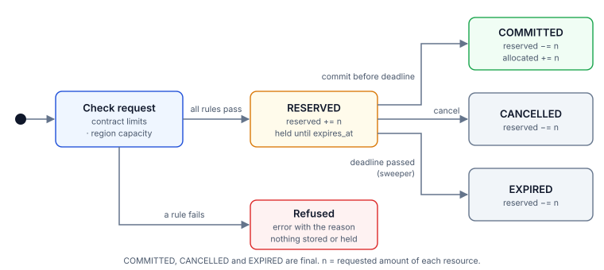
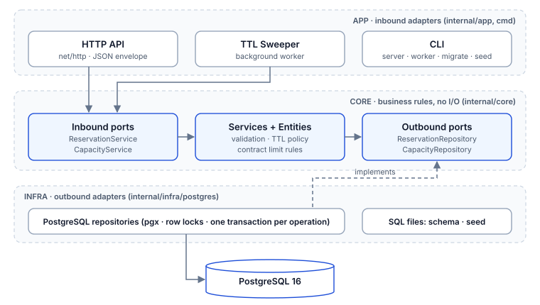
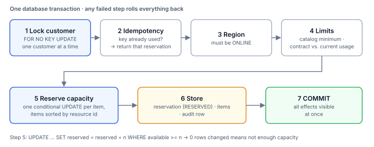
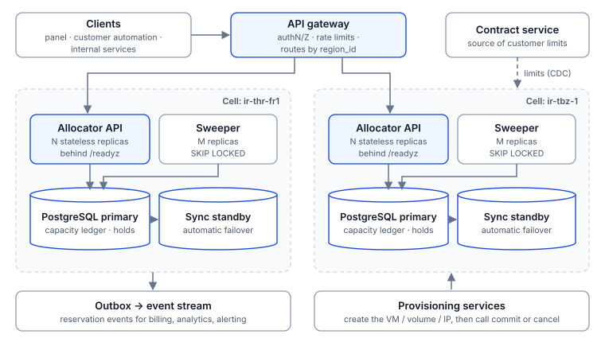

# مستند طراحی و معماری سامانه تخصیص ظرفیت منابع ابری

**Cloud Capacity Allocator** · مخزن کد: <https://github.com/Ehsan-Eghbali/cloud-capacity> · نسخه انگلیسی: [ARCHITECTURE.md](ARCHITECTURE.md)

---

## ۱. خلاصه

این سامانه هسته Backend فرایندی است که پیش از ساخت یک سرویس ابری اجرا می‌شود: مشخص می‌کند منابع موردنیاز مشتری قابل ارائه هستند یا نه، در صورت امکان آن‌ها را برای مدت کوتاهی برای مشتری **نگه می‌دارد (Hold)** و در پایان، رزرو را **نهایی (Commit)**، **لغو (Cancel)** یا پس از پایان مهلت **منقضی (Expire)** می‌کند.

سه تضمین اصلی طراحی:

1. **ظرفیتی که به مشتری «بله» گفته شده تا پایان مهلت برای خودش می‌ماند** و هیچ منبعی بیش از ظرفیت قابل‌فروش واگذار نمی‌شود.
2. **ارسال دوباره یک درخواست، رزرو دوم نمی‌سازد**؛ همان رزرو قبلی برمی‌گردد و چیزی دوبار کسر نمی‌شود.
3. **هیچ رزروی نیمه‌کاره نمی‌ماند**؛ هر Hold یا نهایی می‌شود، یا لغو، یا خودکار منقضی، و همه تغییرها قابل ردگیری هستند.

پیاده‌سازی با Go و PostgreSQL انجام شده و با یک دستور `docker compose up --build` اجرا می‌شود.

## ۲. مسئله و پاسخ طراحی

| مشکل مطرح‌شده در صورت مسئله | پاسخ طراحی |
|---|---|
| مشتری ظرفیتی را می‌بیند اما هنگام ساخت سرویس دیگر موجود نیست | رزرو دومرحله‌ای: ظرفیت در لحظه پذیرش درخواست کسر و تا `expires_at` نگه داشته می‌شود. مشاهده ظرفیت فقط یک تصویر لحظه‌ای است؛ تضمین فقط با رزرو به دست می‌آید. |
| نتیجه درخواست مشخص نیست و مشتری دوباره آن را می‌فرستد | هر درخواست یک `Idempotency-Key` دارد. تکرار همان کلید همان رزرو را برمی‌گرداند. Commit و Cancel هم تکرارپذیرند. |
| فرایندی آغاز می‌شود ولی هرگز به پایان نمی‌رسد | هر Hold مهلت (TTL) دارد. Sweeper پس‌زمینه ظرفیت Holdهای رهاشده را آزاد می‌کند، حتی پس از کرش یا قطعی. |
| تشخیص ظرفیت واقعی و پیگیری وضعیت دشوار است | یک دفتر واحد برای هر (منطقه، منبع) با سه شمارنده `total / allocated / reserved` و یک Audit Log که در همان تراکنشِ هر تغییر نوشته می‌شود. |
| یک درخواست به چند منبع نیاز دارد | همه منابع یک درخواست در یک تراکنش بررسی و نگه داشته می‌شوند: یا همه، یا هیچ‌کدام. |
| ظرفیت بعضی محصولات محدود است و سریع تمام می‌شود | بررسی موجودی و کسر آن یک دستور اتمیک است و قید `CHECK` در دیتابیس مانع فروش بیش از ظرفیت می‌شود. |
| پنل، اتوماسیون مشتری و سرویس‌های داخلی از سامانه استفاده می‌کنند | یک REST API با قرارداد یکسان، کدهای وضعیت معنادار و پیام روشن برای دلیل رد. |

پنج قابلیت خواسته‌شده و Endpoint متناظر هر کدام در بخش ۱۱ آمده است.

## ۳. فرض‌ها

صورت مسئله جزئیات رفتار را به طراح سپرده است. فرض‌های این طراحی:

**منابع و ظرفیت**

1. ظرفیت به ازای هر زوج (منطقه، نوع منبع) با سه شمارنده نگهداری می‌شود و `available = total − allocated − reserved`.
2. `total_capacity` **ظرفیت قابل‌فروش** است، نه لزوماً ظرفیت فیزیکی. سیاست فروش هر منبع (مثلاً Overcommit برای CPU و فروش یک‌به‌یک برای GPU) با همین عدد توسط تیم عملیات تعیین می‌شود و سامانه هرگز بیش از آن نمی‌فروشد.
3. مقدار همه منابع عدد صحیح مثبت بر حسب واحد پایه است. منابع «قابل تقسیم» (CPU، حافظه، دیسک) یک استخر هستند و منابع «واحد مستقل» (GPU، IP عمومی) شمارش می‌شوند؛ این تفاوت با `is_divisible` در کاتالوگ مشخص است و هر منبع یک حداقل مقدار (`min_amount`) دارد. سامانه تعداد را مدیریت می‌کند؛ انتخاب واحد مشخص (کدام IP یا کدام GPU) کار سرویس Provisioning است.
4. «محصول» (مثل ماشین مجازی) ترکیبی از منابع است که درخواست‌دهنده مشخص می‌کند. سامانه کاتالوگ محصول ندارد و اطلاعات محصول در `metadata` درخواست می‌آید.
5. هر درخواست دقیقاً به یک منطقه مربوط است.
6. مناطق، کاتالوگ منابع، ظرفیت‌ها، مشتریان و قراردادها را سامانه‌های دیگر مدیریت می‌کنند و اینجا با Seed وارد می‌شوند.

**محدودیت‌های مشتری**

7. محدودیت هر مشتری به ازای هر نوع منبع تعریف می‌شود: سقف کل، حداقل و حداکثر هر درخواست، و مجاز بودن یا نبودن منبع.
8. **سقف قرارداد کلی است**: مصرف مشتری در همه مناطق با هم جمع می‌شود، چون قرارداد با مشتری بسته می‌شود نه با دیتاسنتر.
9. مصرف مشتری برابر است با مجموع رزروهای `RESERVED` و `COMMITTED`. رزروهای لغوشده و منقضی مصرف حساب نمی‌شوند.
10. اگر برای منبعی هیچ سطر قراردادی وجود نداشته باشد، فقط حداقل کاتالوگ و ظرفیت منطقه اعمال می‌شود. برای ممنوع کردن یک منبع، سطر قرارداد با `is_enabled = false` ثبت می‌شود.

**چرخه عمر**

11. درخواست همان لحظه بررسی می‌شود: یا رزرو ساخته می‌شود، یا با ذکر دلیل رد می‌شود. صف انتظار و تخصیص جزئی وجود ندارد.
12. درخواست ردشده ذخیره نمی‌شود. دلیل رد در پاسخ همان درخواست می‌آید و ارسال دوباره (حتی با همان کلید) از نو بررسی می‌شود.
13. مهلت Hold را سرور تعیین می‌کند (پیش‌فرض ۶۰۰ ثانیه، قابل تنظیم). کلاینت آن را انتخاب نمی‌کند و مقدار اعمال‌شده در پاسخ برمی‌گردد.
14. Commit پس از پایان مهلت پذیرفته نمی‌شود، حتی اگر Sweeper هنوز آن Hold را آزاد نکرده باشد.
15. `COMMITTED` در این محدوده وضعیت پایانی است. آزادسازی ظرفیت هنگام حذف سرویس خارج از محدوده است (بخش ۱۴).

**Idempotency، هویت و زمان**

16. `Idempotency-Key` برای ثبت درخواست اجباری است، در محدوده هر مشتری یکتاست و تا زمانی که رزرو وجود دارد معتبر می‌ماند.
17. دو درخواست وقتی «یکسان» هستند که منطقه و مقدار هر منبع در آن‌ها برابر باشد؛ `metadata` در این مقایسه نیست. هر منبع فقط یک بار در درخواست می‌آید و تکرار آن با `400` رد می‌شود.
18. احراز هویت خارج از محدوده است. `customer_id` را یک Gateway بالادستی تأیید کرده و شناسه رزرو برای مشاهده، Commit و Cancel کافی است.
19. همه مهلت‌ها با ساعت دیتابیس محاسبه و مقایسه می‌شوند، نه ساعت سرویس.
20. PostgreSQL مرجع واحد حقیقت است. در نبود دیتابیس، سامانه درخواست را نمی‌پذیرد و حالت جایگزین در حافظه ندارد (سازگاری بر دسترس‌پذیری مقدم است).

## ۴. مدل داده

| جدول | محتوا | نکته کلیدی |
|---|---|---|
| `regions` | مناطق و وضعیت آن‌ها | فقط منطقه `ONLINE` درخواست جدید می‌پذیرد |
| `resource_types` | کاتالوگ منابع | `is_divisible`، `min_amount`، واحد |
| `region_capacities` | دفتر ظرفیت هر (منطقه، منبع) | `CHECK (allocated + reserved <= total)` و غیرمنفی بودن شمارنده‌ها |
| `customers` | مشتریان | فقط مشتری `ACTIVE` می‌تواند رزرو کند |
| `customer_limits` | قرارداد مشتری | یک سطر به ازای هر (مشتری، منبع) |
| `reservations` | رزروها و وضعیت آن‌ها | `UNIQUE (customer_id, idempotency_key)` و `CHECK` روی مقادیر وضعیت |
| `reservation_items` | مقدار هر منبع در یک رزرو | یک سطر به ازای هر منبع، `amount > 0` |
| `capacity_audit_logs` | تاریخچه تغییرها | در همان تراکنش تغییر نوشته می‌شود |

قیدهای `CHECK` لایه دوم دفاع هستند: حتی اگر در کد خطایی وجود داشته باشد، دیتابیس اجازه منفی شدن شمارنده یا فروش بیش از ظرفیت را نمی‌دهد و تراکنش برمی‌گردد.

## ۵. چرخه عمر رزرو



| گذار | آغازگر | اثر روی دفتر ظرفیت | اثر روی سهمیه مشتری |
|---|---|---|---|
| ثبت ← `RESERVED` | مشتری | `reserved += n` | مصرف می‌شود |
| `RESERVED → COMMITTED` | مشتری یا سرویس Provisioning | `reserved −= n` و `allocated += n` | مصرف‌شده می‌ماند |
| `RESERVED → CANCELLED` | مشتری | `reserved −= n` | آزاد می‌شود |
| `RESERVED → EXPIRED` | Sweeper | `reserved −= n` | آزاد می‌شود |

سه وضعیت `COMMITTED`، `CANCELLED` و `EXPIRED` پایانی هستند. درخواستی که پذیرفته نشود رزروی نمی‌سازد و هیچ شمارنده‌ای را تغییر نمی‌دهد.

## ۶. معماری نرم‌افزار



ساختار پروژه Hexagonal (Ports and Adapters) است:

- **Core** (`internal/core`): موجودیت‌ها، قواعد قرارداد، اعتبارسنجی و Interfaceها. هیچ وابستگی به HTTP یا دیتابیس ندارد.
- **App** (`internal/app`, `cmd`): ورودی‌های سامانه؛ HTTP API، Sweeper و دستورهای CLI.
- **Infra** (`internal/infra/postgres`): پیاده‌سازی Repositoryها روی PostgreSQL. همه تراکنش‌ها اینجاست.

بررسی سقف قرارداد و کسر ظرفیت باید زیر قفل و در یک تراکنش انجام شود؛ به همین دلیل Repository مراحل را داخل تراکنش اجرا می‌کند و قاعده قرارداد (`CustomerLimit.Validate`) در Core می‌ماند.

**چرا PostgreSQL؟** مسئله در اصل یک مسئله سازگاری است: چند شمارنده و چند رکورد باید با هم و اتمیک تغییر کنند. تراکنش ACID، قفل ردیفی و قید `CHECK` دقیقاً همین را بدون ابزار اضافه فراهم می‌کنند. استفاده از Cache یا قفل توزیع‌شده در کنار دیتابیس، یک مرجع حقیقت دوم و حالت‌های خرابی بیشتری می‌ساخت.

## ۷. پردازش یک درخواست رزرو



کل کار در **یک تراکنش** انجام می‌شود و شکست هر مرحله همه چیز را برمی‌گرداند:

1. **قفل مشتری.** درخواست‌های یک مشتری پشت‌سرهم پردازش می‌شوند. این کار سقف کلی قرارداد را بین مناطق درست نگه می‌دارد و تکرارهای همزمان یک کلید را به صف می‌کند.
2. **بررسی Idempotency.** اگر مشتری این کلید را قبلاً استفاده کرده باشد، همان رزرو برمی‌گردد.
3. **منطقه.** باید وجود داشته باشد و `ONLINE` باشد.
4. **محدودیت‌ها.** برای هر منبع: وجود در کاتالوگ، حداقل مقدار کاتالوگ، و سقف‌های قرارداد در برابر مصرف فعلی مشتری.
5. **کسر ظرفیت.** برای هر منبع یک `UPDATE` شرطی اجرا می‌شود که فقط وقتی موجودی کافی باشد `reserved` را زیاد می‌کند. اگر ردیفی تغییر نکند، ظرفیت کافی نیست.
6. **ثبت.** رزرو با وضعیت `RESERVED`، آیتم‌ها و یک سطر Audit ذخیره می‌شوند.

| دلیل رد | HTTP |
|---|---|
| ظرفیت منطقه کافی نیست | 409 |
| عبور از سقف کل قرارداد | 422 |
| منبع در قرارداد مشتری غیرفعال است | 422 |
| بیشتر از حداکثر یا کمتر از حداقل هر درخواست | 422 |
| منبع ناشناخته است یا در این منطقه ارائه نمی‌شود | 422 |

کمبود ظرفیت 409 است چون با تغییر وضعیت سامانه ممکن است بعداً موفق شود؛ بقیه موارد تا تغییر قرارداد یا درخواست تکرار می‌شوند.

## ۸. همزمانی و سازگاری

**جلوگیری از فروش بیش از ظرفیت.** بررسی موجودی و کسر آن یک دستور است:

```sql
UPDATE region_capacities
SET reserved_capacity = reserved_capacity + $1
WHERE region_id = $2 AND resource_type_id = $3
  AND total_capacity - allocated_capacity - reserved_capacity >= $1;
```

PostgreSQL هنگام اجرای `UPDATE` ردیف را قفل می‌کند، پس دو درخواست همزمان نمی‌توانند یک موجودی را ببینند و هر دو بردارند؛ دومی پس از اولی و روی مقدار جدید ارزیابی می‌شود.

**سقف قرارداد.** مصرف مشتری از روی رزروهایش محاسبه می‌شود. بدون قفل مشتری، دو درخواست همزمان در دو منطقه (که ردیف ظرفیت مشترکی ندارند) هر دو مصرف قبلی را می‌دیدند و هر دو پذیرفته می‌شدند. قفل `FOR NO KEY UPDATE` روی ردیف مشتری این حالت را حذف می‌کند.

**ترتیب قفل‌ها.** همه تراکنش‌ها قفل‌ها را به یک ترتیب می‌گیرند:

1. ردیف مشتری (فقط در ثبت رزرو)
2. ردیف رزرو (در Commit، Cancel و Expire)
3. ردیف‌های ظرفیت به ترتیب صعودی شناسه منبع

هر تراکنش فقط به ردیف‌های ظرفیت یک منطقه دست می‌زند و آیتم‌های هر رزرو مرتب ذخیره می‌شوند، پس این ترتیب در همه مسیرها یکسان است. چون هیچ تراکنشی قفل‌ها را برخلاف این ترتیب نمی‌گیرد، چرخه انتظار و در نتیجه Deadlock شکل نمی‌گیرد. Sweeper هر Hold منقضی را در تراکنش جداگانه خودش آزاد می‌کند تا همین قاعده برقرار بماند.

**سطح Isolation.** پیش‌فرض PostgreSQL یعنی `READ COMMITTED` کافی است، چون هر تصمیم زیر قفل ردیف مربوط به خودش گرفته می‌شود و هر دستور پس از گرفتن قفل، آخرین داده Commit‌شده را می‌بیند.

**هزینه این طراحی.** درخواست‌های یک مشتری و درخواست‌های یک (منطقه، منبع) سریالی می‌شوند. تراکنش‌ها کوتاه‌اند و این برای بار این مسئله مناسب است؛ مسیر افزایش مقیاس در بخش ۱۲ آمده است.

## ۹. Idempotency و ارسال دوباره

| وضعیت | رفتار |
|---|---|
| اولین درخواست با یک کلید | بررسی می‌شود: `201` و ساخت رزرو، یا رد با دلیل |
| همان کلید، همان درخواست | `200` و همان رزرو قبلی؛ چیزی دوباره کسر نمی‌شود |
| همان کلید، درخواست متفاوت | `422`؛ رزرو قبلی دست‌نخورده می‌ماند |
| چند ارسال همزمان با یک کلید | پشت قفل مشتری به صف می‌شوند؛ یکی رزرو را می‌سازد و بقیه همان را می‌گیرند. قید یکتایی دیتابیس لایه دوم است |
| درخواستی که رد شده | کلید مصرف نمی‌شود؛ ارسال دوباره از نو بررسی می‌شود |
| تکرار Commit روی رزرو Commit‌شده | `200` با همان پاسخ، بدون اثر دوباره |
| تکرار Cancel روی رزرو لغوشده | `200` با همان پاسخ، بدون اثر دوباره |

کلید را می‌توان در هدر `Idempotency-Key` یا در فیلد `idempotency_key` بدنه فرستاد؛ هدر اولویت دارد.

## ۱۰. خرابی و بازیابی

اصل طراحی: **هر عملیات یک تراکنش دیتابیس است و سرویس هیچ وضعیتی در حافظه نگه نمی‌دارد.** پس هر خرابی یا قبل از Commit تراکنش رخ می‌دهد (هیچ اثری نمی‌ماند) یا بعد از آن (اثر کامل ثبت شده است).

| رخداد | رفتار هنگام خرابی | وضعیت پس از بازیابی |
|---|---|---|
| کرش سرویس وسط پردازش یک درخواست | تراکنش ناتمام را PostgreSQL برمی‌گرداند | هیچ اثر ناقصی وجود ندارد؛ مشتری با همان کلید دوباره می‌فرستد |
| قطع ارتباط پس از ثبت و پیش از رسیدن پاسخ | رزرو ثبت شده ولی مشتری نمی‌داند | ارسال دوباره با همان کلید همان رزرو را برمی‌گرداند |
| از دسترس خارج شدن PostgreSQL | `/readyz` پاسخ 503 می‌دهد تا Load Balancer ترافیک نفرستد؛ `/healthz` سالم می‌ماند تا سرویس بی‌دلیل Restart نشود؛ درخواست‌ها خطای 500 می‌گیرند و چیزی ثبت نمی‌شود | Connection Pool خودش دوباره وصل می‌شود و `/readyz` سبز می‌شود |
| پایان مهلت Holdها در زمان قطعی یا خاموشی | ظرفیت آن‌ها موقتاً آزاد نمی‌شود، اما قابل Commit هم نیستند | Sweeper در اولین اجرا پس از راه‌اندازی همه آن‌ها را منقضی و ظرفیت را آزاد می‌کند |
| رها شدن فرایند توسط مشتری | Hold تا پایان مهلت می‌ماند | `EXPIRED` و آزادسازی ظرفیت |
| اجرای همزمان چند نسخه از سرویس یا Sweeper | هر Hold با یک `UPDATE` شرطی منقضی می‌شود | هر Hold دقیقاً یک بار منقضی می‌شود |
| خاموشی عادی (`SIGTERM`) | درخواست‌های در جریان تمام می‌شوند، Sweeper متوقف و Pool بسته می‌شود | راه‌اندازی بعدی از وضعیت دیتابیس ادامه می‌دهد |

سناریوی قطعی دیتابیس روی نسخه در حال اجرا آزموده شده است: ثبت Hold، توقف PostgreSQL، گذشتن مهلت، راه‌اندازی دوباره. نتیجه: در زمان قطعی `/readyz` برابر 503 و درخواست‌ها ناموفق؛ پس از بازگشت Hold قدیمی `EXPIRED` و ظرفیت آزاد؛ و درخواستِ ناموفقِ زمان قطعی با همان کلید یک بار ثبت شد.

**توضیح‌پذیری.** هر تغییر وضعیت یک سطر در `capacity_audit_logs` دارد (`RESERVE`، `COMMIT`، `CANCEL`، `EXPIRE`) که در همان تراکنش نوشته می‌شود؛ پس تاریخچه با وضعیت واقعی همیشه همخوان است. برای بررسی درستی دفتر پس از یک حادثه، این پرس‌وجو نباید هیچ سطری برگرداند:

```sql
SELECT c.region_id, c.resource_type_id, c.reserved_capacity,
       COALESCE(SUM(ri.amount) FILTER (WHERE r.status = 'RESERVED'), 0) AS live_holds
FROM region_capacities c
LEFT JOIN reservations r       ON r.region_id = c.region_id
LEFT JOIN reservation_items ri ON ri.reservation_id = r.id
                              AND ri.resource_type_id = c.resource_type_id
GROUP BY c.region_id, c.resource_type_id, c.reserved_capacity
HAVING c.reserved_capacity <> COALESCE(SUM(ri.amount) FILTER (WHERE r.status = 'RESERVED'), 0);
```

همین شرط در آزمون‌های یکپارچه پس از هر سناریوی همزمانی بررسی می‌شود.

## ۱۱. API

همه پاسخ‌ها قالب `{"success": bool, "data": …, "error": "…"}` دارند.

| نیاز | متد و مسیر | توضیح |
|---|---|---|
| ۱. مشاهده وضعیت ظرفیت | `GET /api/v1/regions` | فهرست مناطق و وضعیت آن‌ها |
| | `GET /api/v1/regions/{region_id}/capacity` | شمارنده‌ها و موجودی هر منبع |
| | `GET /api/v1/resources` | کاتالوگ منابع |
| ۲. ثبت درخواست | `POST /api/v1/reservations` | با `Idempotency-Key` |
| ۳. پیگیری وضعیت | `GET /api/v1/reservations/{id}` | وضعیت و مهلت رزرو |
| ۴. تکمیل یا لغو | `POST /api/v1/reservations/{id}/commit` | نهایی‌سازی |
| | `POST /api/v1/reservations/{id}/cancel` | لغو و آزادسازی |
| ۵. درخواست‌های قبلی | `GET /api/v1/reservations?customer_id=…` | جدیدترین اول؛ `status`، `page`، `page_size` |
| سلامت | `GET /healthz` ، `GET /readyz` | Liveness و Readiness |

| کد | معنا |
|---|---|
| `200` | موفق؛ یا تکرار یک عملیات قبلاً انجام‌شده |
| `201` | رزرو جدید ساخته شد |
| `400` | ورودی نامعتبر (بدنه، شناسه، کلید، مقدار، منبع تکراری) |
| `403` | مشتری فعال نیست |
| `404` | مشتری، منطقه یا رزرو پیدا نشد |
| `409` | کمبود ظرفیت؛ منطقه در دسترس نیست؛ وضعیت رزرو اجازه این عملیات را نمی‌دهد؛ مهلت تمام شده |
| `422` | رد بر اساس قرارداد یا کاتالوگ؛ کلید تکراری با درخواست متفاوت |
| `500` | خطای داخلی یا در دسترس نبودن دیتابیس؛ با همان کلید می‌توان دوباره تلاش کرد |

نمونه درخواست و پاسخ‌ها در [README](../README.md) آمده است.

## ۱۲. توسعه در محیط واقعی



پیاده‌سازی فعلی یک سرویس و یک دیتابیس است. مسیر رسیدن به محیط واقعی:

**چندمنطقه‌ای.** ظرفیت ذاتاً منطقه‌ای است، پس هر منطقه یک Cell مستقل می‌شود: نسخه‌های Allocator به همراه PostgreSQL همان منطقه. Gateway درخواست را بر اساس `region_id` مسیریابی می‌کند و قطعی یک منطقه یا شبکه بین مناطق، رزرو در منطقه دیگر را متوقف نمی‌کند. طراحی فعلی با این تقسیم سازگار است، چون هر درخواست فقط به یک منطقه مربوط است و همه قفل‌های ظرفیت درون همان منطقه هستند.

**سقف کلی قرارداد بین Cellها.** امروز چون یک دیتابیس داریم، قفل مشتری این سقف را دقیق نگه می‌دارد. با جدا شدن دیتابیس‌ها دو راه وجود دارد: بررسی همزمان در یک سرویس مرکزی (ساده ولی مناطق را به هم وابسته می‌کند)، یا تقسیم سقف هر مشتری به سهم‌های منطقه‌ای که هر Cell محلی اعمال می‌کند و یک سرویس مرکزی آن‌ها را بازتوزیع می‌کند. راه دوم پیشنهاد می‌شود، چون رزرو در یک منطقه به سلامت مناطق دیگر وابسته نمی‌ماند.

**دسترس‌پذیری.** PostgreSQL با یک Standby همگام و Failover خودکار (مثلاً Patroni) تا رزرو تأییدشده از دست نرود. سرویس Stateless است و به هر تعداد نسخه پشت `/readyz` اجرا می‌شود. Sweeper با دستور `worker` جدا مستقر می‌شود.

**مقیاس.** گلوگاه طبیعی، ردیف شمارنده یک منبع پرتقاضا است. راه افزایش ظرفیت، شکستن آن به استخرهای کوچک‌تر در سطح Availability Zone، کلاستر یا Host Aggregate است که با واقعیت زیرساخت هم منطبق‌تر است. جدول‌های `reservations` و `capacity_audit_logs` بر اساس زمان Partition و داده قدیمی بایگانی می‌شود.

**مشاهده‌پذیری.** Metric برای تعداد Hold در هر وضعیت، نرخ هر دلیل رد، فاصله Hold تا Commit، نسبت Holdهای منقضی و زمان انتظار قفل؛ Trace برای هر درخواست؛ و هشدار روی پرس‌وجوی سازگاری بخش ۱۰.

**یکپارچگی با سایر سامانه‌ها.** رویدادهای رزرو با الگوی Outbox (نوشتن رویداد در همان تراکنش) برای صورتحساب و تحلیل منتشر می‌شوند. قراردادها با CDC از سامانه مرجع به هر Cell می‌رسند.

**امنیت.** احراز هویت و Rate Limit در Gateway؛ `customer_id` از Token خوانده می‌شود و مالکیت رزرو در Commit و Cancel بررسی می‌شود.

**قابلیت‌های بعدی.** گذار `release` برای آزادسازی ظرفیت هنگام حذف سرویس، تمدید Hold برای Provisioning طولانی، ثبت درخواست‌های ردشده برای گزارش‌گیری، کاتالوگ محصول، API مدیریت ظرفیت برای تیم عملیات، و ابزار Migration نسخه‌دار.

## ۱۳. آزمون و راه‌اندازی

```bash
docker compose up --build -d      # PostgreSQL + migration + seed + service
curl http://localhost:8080/readyz
make test                         # unit tests, no database needed
make test-integration             # integration tests on PostgreSQL
```

اگر پورت `5432` یا `8080` روی میزبان اشغال است:

```bash
POSTGRES_HOST_PORT=5433 APP_PORT=8081 docker compose up --build -d
```

| سطح | چه چیزی را می‌آزماید |
|---|---|
| واحد: `entity` | قواعد سقف قرارداد، محاسبه موجودی، تشخیص درخواست یکسان |
| واحد: `service` | اعتبارسنجی ورودی (از جمله منبع تکراری)، مهلت Hold از تنظیمات، صفحه‌بندی |
| واحد: `http` | کدهای وضعیت، اولویت هدر کلید، نشت نکردن خطای داخلی، Readiness |
| یکپارچه | عدم فروش بیش از ظرفیت زیر بار همزمان؛ سقف قرارداد در یک منطقه و بین دو منطقه؛ یک رزرو از ۲۰ تکرار همزمان؛ نبود Deadlock بین Sweeper و ثبت رزرو؛ Commit، Cancel و Expire و تکرار آن‌ها؛ دلایل رد؛ تاریخچه |

آزمون‌های یکپارچه پس از هر سناریو سازگاری دفتر ظرفیت را بررسی می‌کنند. برای اطمینان از حساس بودن آزمون‌ها، سه محافظ کلیدی (قفل مشتری، ترتیب قفل ردیف‌های ظرفیت و شرط موجودی) هر کدام موقتاً برداشته شدند و آزمون‌های مربوط شکست خوردند.

## ۱۴. محدودیت‌های شناخته‌شده

- **آزادسازی پس از Commit وجود ندارد.** ظرفیت و سهمیه `COMMITTED` تا تعریف گذار `release` آزاد نمی‌شود.
- **تمدید Hold وجود ندارد.** اگر Provisioning از مهلت طولانی‌تر شود، Commit رد می‌شود و سرویس بالادستی باید دوباره رزرو کند. تا آن زمان TTL باید متناسب با کندترین محصول انتخاب شود.
- **هر درخواست یک منطقه.** سرویس چندمنطقه‌ای باید چند رزرو بگیرد و خودش آن‌ها را هماهنگ کند.
- **مشاهده ظرفیت تضمین نیست.** عدد `available` می‌تواند تا لحظه ثبت درخواست تغییر کند.
- **Hold منقضی تا اجرای بعدی Sweeper (پیش‌فرض ۵ ثانیه) هنوز `RESERVED` دیده می‌شود و ظرفیتش آزاد نشده است.** Commit این تأخیر را ندارد و مهلت را دقیق اعمال می‌کند.
- **درخواست ردشده در تاریخچه نیست.** تاریخچه فقط رزروهای ساخته‌شده را نشان می‌دهد.
- **Migration بدون جدول نسخه.** یک فایل Schema وجود دارد که تکرارپذیر نوشته شده است؛ برای محیط واقعی ابزار نسخه‌دار لازم است.
- **صفحه‌بندی با Offset.** برای تاریخچه‌های بسیار بزرگ باید به Keyset تبدیل شود.
